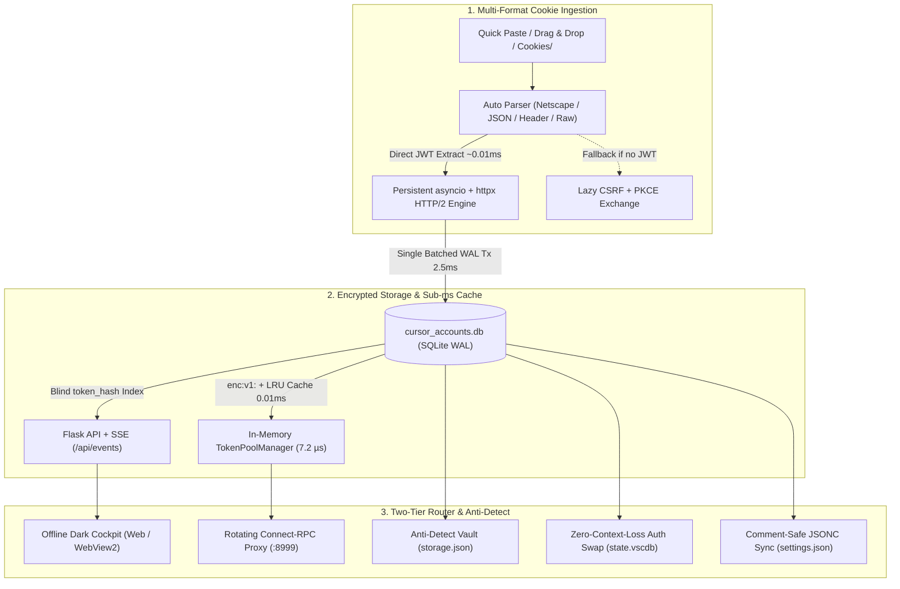

# 🚀 CursorRouter v3.0

<p align="center">
  <a href="https://github.com/darwnlinz1/CursorRouter/releases"></a>
  <a href="tests/"></a>
  <a href="https://www.python.org/"></a>
  <a href="https://cursor.com/"></a>
  <a href="LICENSE"></a>
  <a href="https://microsoft.com"></a>
</p>

<p align="center">
  <b>High-speed local account pool manager, HTTP/2 multiplexed quota sync engine, zero-downtime Connect-RPC rotating proxy, anti-detect hardware isolator, and offline-first dark cockpit built for Cursor IDE.</b>
</p>

---

## ⚡ v3.0 Empirical Performance Benchmarks

Benchmarked end-to-end against live `api2.cursor.sh` endpoints, PBKDF2 token cryptography, and SQLite persistence (reproducible via `python scripts/benchmark_architectures.py`):

| Subsystem | Legacy (v2.x) | **CursorRouter v3.0** | Speedup |
| :--- | :---: | :---: | :---: |
| **8-Account Live Quota Sync (Warm)** | `6,937.7 ms` (unpooled `requests`, 3 RPCs, 5w) | **`372.8 ms`** (persistent `httpx` HTTP/2, coalesced stream) | **~18.6× faster** |
| **8-Account Cold Full Sync + DB Commit** | `6,937.7 ms` | **`1,860.5 ms`** (Cold H2 + 2-RPC + Batched WAL) | **~3.7× faster** |
| **Token Decryption (100 acc × 3 fields)** | `1,334.14 ms` (uncached PBKDF2) | **`0.0111 ms`** (bounded LRU decrypt cache) | **120,000× faster** |
| **SQLite Batch Persistence (50 accounts)** | `284.78 ms` (3 commits/row) | **`2.49 ms`** (single batched WAL transaction) | **114× faster** |
| **Proxy RAM Token Lookup** | SQLite round-trip (`~3–8 ms`) | **`0.0072 ms` (`7.2 µs`)** (in-memory decrypted pool) | **Zero-RTT swap** |
| **UI Initial Paint & Offline Load** | 5,321-line HTML + Tailwind CDN + Google Fonts | **100% Local CSS/JS** + 1-RTT `/api/dashboard/snapshot` + SSE | **Instant / Offline** |

---

## 🌟 Key Features (v3.0 Overhaul)

- ⚡ **Persistent Async HTTP/2 Sync Engine (`src/async_sync_engine.py`)**:
  - Dedicated background asyncio runtime reusing coalesced HTTP/2 TLS connections (`httpx.AsyncClient(http2=True, max_connections=4)`).
  - Extracts valid Session JWTs directly from `WorkosCursorSessionToken` (`~0.01 ms`), bypassing unnecessary CSRF-gated PKCE exchanges, and transparently handles lazy double-submit CSRF if PKCE fallback is required.
  - Never discards working accounts based on stale local JWT `exp` claims — verifies live via multiplexed HTTP/2.
- 📋 **Instant Cookie Ingestion Workbench (Quick Paste + Dropzone)**:
  - **Paste directly from clipboard** (`POST /api/cookies/paste`) or drag & drop files — auto-detects **Netscape TSV** (with `#` comments), **JSON Cookie arrays** (EditThisCookie / Cookie-Editor), **HTTP `Cookie:` headers**, **`email|cookie`** batch lines, and **raw tokens**.
- 🛡️ **Anti-Detect Hardware Isolation (`account_locked`, `always_random`, `native_standard`)**:
  - Binds persistent randomized hardware identifiers (`machineId`, `macMachineId`, `devDeviceId`, `sqmId`) per account in SQLite, restoring the exact identity into `storage.json` on switch (and strictly honoring `native_standard` without modifying host IDs).
- 🔐 **End-to-End Token Security & Blind Indexing**:
  - Machine-bound PBKDF2-HMAC encryption (`enc:v1:`) with bounded LRU decrypt cache (`src/token_cipher.py`), SHA-256 `token_hash` blind indexing for instant DB queries, and strict secret redaction on `/api/accounts` and `/api/status` (raw JWTs are never broadcast to list/status endpoints).
- 🔀 **Two-Tier Priority Router + Zero-Downtime Proxy (`:8999`)**:
  - **Tier 1 (`< 50%`)** dispatched first, **Tier 2 (`50–99%`)** as automatic fallback, and cooldown quarantine for `≥ 100%` / rate-limited accounts.
  - Local Connect-RPC Rotating Proxy auto-swaps on `429`/`401` in sub-millisecond RAM lookup (`7.2 µs`).
- 📝 **Comment-Safe JSONC Settings Sync (`src/jsonc_utils.py`)**:
  - Bi-directional 8-category Cursor IDE settings sync that preserves comments & URLs (`http://127.0.0.1:8999`) in `%APPDATA%\Cursor\User\settings.json`. Profile overrides on switch are strictly opt-in (`apply_profile_on_switch: false` by default).
- 🖥️ **Offline-First Dark Cockpit + SSE Live Stream**:
  - Zero external CDN dependencies (works 100% offline inside WebView2 & browser), modular CSS/JS (`static/css/`, `static/js/`), unified `/api/dashboard/snapshot` + Server-Sent Events (`/api/events`), live proxy telemetry, and keyboard shortcuts (`Esc`, `Ctrl+F`, `Ctrl+Shift+D`, `Ctrl+Alt+S`, `Ctrl+Alt+U`).

---

## 🏗️ v3.0 System Architecture



---

## 📥 Downloads & Releases

| Platform | Architecture | Package Type | Download Link |
| :--- | :--- | :--- | :--- |
| **Windows 10 / 11** | `x64` | Standalone `.exe` (WebView2) | [Download Latest Release](https://github.com/darwnlinz1/CursorRouter/releases/latest) |
| **Windows 10 / 11** | `x64` | Portable Source Archive | [Source Code (zip)](https://github.com/darwnlinz1/CursorRouter/archive/refs/heads/main.zip) |

*For building portable/frozen executables with safe writable data paths (`src/app_paths.py`), see [Desktop App Packaging Guide](desktop_app/README.md).*

---

## 🚀 Getting Started

### Prerequisites
- **Windows 10 / 11** (64-bit)
- **Python 3.10+** (with `pip`)
- **Cursor IDE** installed at `%LOCALAPPDATA%\Programs\cursor\Cursor.exe`

### 1. Installation
```bash
git clone https://github.com/darwnlinz1/CursorRouter.git
cd CursorRouter
pip install -r requirements.txt
```

### 2. Launch CursorRouter
- **Web Dashboard Mode** (`http://127.0.0.1:7860`):
  ```bash
  python main.py
  ```
- **Native Desktop App Mode (WebView2)**:
  ```bash
  python main.py --native
  ```

### 3. Run Architecture Speed Benchmark
```bash
# Run full benchmark (Network HTTP/2 + Crypto LRU + SQLite WAL)
python scripts/benchmark_architectures.py --cookies-dir Cookies

# Run local-only benchmark (Crypto + SQLite, no cookies needed)
python scripts/benchmark_architectures.py --skip-network
```

---

## 📦 Project Structure

```text
CursorRouter/
├── main.py                         # Unified CLI & localhost server entrypoint
├── native_app.py                   # Native desktop launcher
├── build_standalone_exe.py         # Standalone Windows executable builder
├── scripts/
│   └── benchmark_architectures.py  # Reproducible 3-suite speed benchmark harness
├── src/
│   ├── app_paths.py                # Frozen/portable/source-aware writable data paths
│   ├── async_sync_engine.py        # Persistent asyncio + httpx HTTP/2 sync engine
│   ├── jsonc_utils.py              # String-aware JSONC comment stripper & atomic writer
│   ├── account_pool.py             # SQLite WAL pool, batched writes, blind token_hash index
│   ├── token_cipher.py             # PBKDF2-HMAC cipher + bounded LRU decrypt cache
│   ├── token_pool.py               # Sub-millisecond decrypted RAM pool for proxy
│   ├── rotating_proxy.py           # Connect-RPC auto-rotating proxy (:8999)
│   ├── pkce_auth.py                # Multi-format cookie parser, direct JWT + lazy CSRF PKCE
│   ├── cursor_settings.py          # 8-category JSONC settings & Anti-Detect fingerprint manager
│   ├── cursor_storage.py           # Zero-context-loss state.vscdb auth injector
│   ├── cursor_reloader.py          # Win32 window control, process reboot & modifier unstick
│   ├── server.py                   # Flask API, /api/dashboard/snapshot, /api/events SSE
│   ├── updater.py                  # GitHub Releases auto-updater (darwnlinz1/CursorRouter)
│   ├── ai_optimizer.py             # Quota burn-rate EMA predictor
│   ├── chat_lock_detector.py       # Chat lockout & Connect-RPC quota error detector
│   ├── smart_task_filter.py        # Continuation filter
│   └── windows_notifier.py         # Win32 Toast Notifications
├── static/
│   ├── css/                        # tokens.css, app.css (100% offline, zero CDN)
│   └── js/                         # utils.js, cockpit.js, modals.js
├── templates/
│   └── index.html                  # Offline dark cockpit shell
├── desktop_app/                    # PyWebView2 standalone desktop packaging
└── tests/                          # Automated Pytest suite
```

---

## 🎛️ Key REST & SSE Endpoints

| Endpoint | Method | Description |
| :--- | :--- | :--- |
| `/api/dashboard/snapshot` | `GET` | Unified 1-RTT state snapshot (`?include_accounts=1&since_version=N`). |
| `/api/events` | `GET` | Real-time Server-Sent Events (SSE) push stream. |
| `/api/cookies/paste` | `POST` | Instant clipboard cookie ingestion (Netscape, JSON, Header, Batch, Raw). |
| `/api/cookies/convert` | `POST` | Scan `Cookies/` and run parallel HTTP/2 quota sync. |
| `/api/accounts` | `GET` | Redacted account list sorted Active → Tier 1 → Tier 2 → Cooldown. |
| `/api/switch/<id>` | `POST` | Switch active account, inject tokens, apply fingerprint & reset Cursor. |
| `/api/auto-switch` | `POST` | Route immediately to the lowest-usage eligible Tier 1 / Tier 2 account. |
| `/api/proxy/status` & `/metrics` | `GET` | Live Rotating Proxy status, swap hops, and TTFT telemetry. |
| `/api/cursor/settings` | `GET / POST` | Comment-safe JSONC sync across all 8 Cursor settings categories. |
| `/api/unstick-keys` | `POST` | Emergency Win32 modifier key release (`Ctrl+Alt+U`). |

---

## 🧪 Testing & Verification

```bash
pytest tests/ -q
```

---

## 🔒 Security & Privacy

- **Localhost-Only by Default**: Server binds strictly to `127.0.0.1:7860` (`--host` opt-in for LAN).
- **Encrypted at Rest & Redacted in Transit**: Tokens in SQLite are encrypted (`enc:v1:`) with machine-bound keys; list and status APIs strip raw JWTs.
- **Git Hygiene**: `Cookies/`, `*.db`, `.cursor_master.key`, and logs are permanently excluded via `.gitignore`.

---

## 📄 License

Distributed under the **MIT License**. See [LICENSE](LICENSE) for details.
