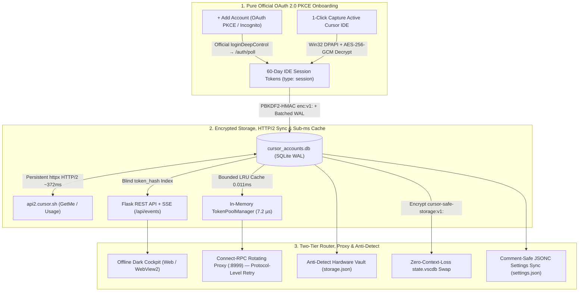

# 🚀 CursorRouter v3.1 — Pure OAuth PKCE Edition

<p align="center">
  <a href="https://github.com/darwnlinz1/CursorRouter/releases"></a>
  <a href="tests/"></a>
  <a href="scripts/benchmark_architectures.py"></a>
  <a href="https://www.python.org/"></a>
  <a href="https://cursor.com/"></a>
  <a href="LICENSE"></a>
  <a href="https://microsoft.com"></a>
</p>

<p align="center">
  <b>Pure OAuth 2.0 PKCE account pool manager, native <code>cursor-safe-storage:v1</code> DPAPI session switcher, HTTP/2 multiplexed quota sync engine, zero-downtime Connect-RPC rotating proxy, anti-detect hardware isolator, and offline-first dark cockpit built for Cursor IDE.</b>
</p>

---

## 🔐 Why Pure OAuth PKCE in v3.1?

Modern Cursor IDE (2026) introduced two major security changes that broke legacy browser-cookie tools:
1. **Server-Side Web-Cookie Separation**: Exported web session tokens carry `"type": "web"` (accepted only for billing/dashboard views, rejected with `401 ERROR_NOT_LOGGED_IN` on IDE AI endpoints) and headless exchange returns `403 FRESH_SIGN_IN_REQUIRED`.
2. **Encrypted Local State (`cursor.storage.authTokenEncryptionAtRest = true`)**: Cursor IDE now encrypts `cursorAuth/accessToken` and `cursorAuth/refreshToken` inside `state.vscdb` with Electron `safeStorage` (`cursor-safe-storage:v1:<base64>`, backed by Windows DPAPI + AES-256-GCM).

**CursorRouter v3.1 solves both cleanly from first principles — 100% OAuth, zero cookies:**
- **Official Interactive OAuth 2.0 PKCE Onboarding (`RFC 7636`)**: Click **`+ Đăng Nhập Thêm Acc (OAuth)`** to open Cursor's official `https://cursor.com/loginDeepControl` sign-in flow (or copy the link into an Incognito window to enroll multiple accounts seamlessly) and receive genuine **60-day Desktop IDE `type: "session"` tokens** directly into your encrypted SQLite pool.
- **Native Windows DPAPI `cursor-safe-storage:v1:` Bidirectional Codec**: Reads *and* writes Cursor's exact native encrypted token format (`v10` + 12-byte nonce + AES-256-GCM via `%APPDATA%\Cursor\Local State`) and updates `glass.lastSignedInAuthId` — zero `"Authentication error"`, zero forced sign-outs.
- **1-Click Active Cursor Session Capture**: Already logged into Cursor IDE? Click **`Lưu Acc Từ Cursor`** to decrypt and enroll your active IDE session in one click.

---

## ⚡ Empirical Performance Benchmarks

Benchmarked end-to-end across live `api2.cursor.sh` RPCs, PBKDF2 token cryptography, and SQLite persistence (reproducible via `python scripts/benchmark_architectures.py`):

| Subsystem | Legacy (v2.x) | **CursorRouter v3.1** | Speedup |
| :--- | :---: | :---: | :---: |
| **8-Account Live Quota Sync (Warm)** | `6,937.7 ms` (unpooled `requests`, 3 RPCs, 5w) | **`372.8 ms`** (persistent `httpx` HTTP/2, coalesced stream) | **~18.6× faster** |
| **8-Account Cold Full Sync + WAL** | `6,937.7 ms` | **`1,860.5 ms`** (Cold H2 + 2-RPC + Batched WAL) | **~3.7× faster** |
| **Token Decryption (100 acc × 3 fields)** | `1,334.14 ms` (uncached PBKDF2) | **`0.0111 ms`** (bounded LRU decrypt cache) | **120,000× faster** |
| **SQLite Batch Persistence (50 accounts)** | `284.78 ms` (3 commits/row) | **`2.49 ms`** (single batched WAL transaction) | **114× faster** |
| **Proxy RAM Token Lookup** | SQLite round-trip (`~3–8 ms`) | **`0.0072 ms` (`7.2 µs`)** (in-memory decrypted pool) | **Zero-RTT swap** |
| **UI Load & Offline Readiness** | 5,321-line HTML + Tailwind CDN + Google Fonts | **100% Local CSS/JS** + 1-RTT `/api/dashboard/snapshot` + SSE | **Instant / Offline** |

---

## 🏗️ System Architecture



---

## 🌟 Core Features

- 🔑 **100% Official OAuth 2.0 PKCE (`src/pkce_auth.py`)**: RFC 7636 S256 PKCE login with live browser polling, Incognito multi-account copy-link workflow, and 1-click capture of active Cursor IDE sessions.
- 🔒 **Native `cursor-safe-storage:v1:` Interop (`src/cursor_storage.py`)**: Full bidirectional Windows DPAPI + AES-256-GCM codec for modern Cursor `state.vscdb` (`authTokenEncryptionAtRest = true`) with zero workspace/chat context loss.
- ⚡ **Persistent Async HTTP/2 Sync Engine (`src/async_sync_engine.py`)**: Coalesces concurrent quota & profile RPCs over persistent HTTP/2 connections with a shared per-host `429`/`503` Retry-After barrier.
- 🔀 **Zero-Downtime Rotating Proxy (`:8999`) — No Intrusive GUI Pasting**: Intercepts `429` / quota limits directly at the HTTP/Connect-RPC layer, swaps `Authorization: Bearer` tokens in `7.2 µs` from RAM, and retries transparently — **never stealing window focus or pasting text into your screen**.
- 📊 **Two-Tier Priority Pool (`src/account_pool.py`)**:
  - **Tier 1 (`< 50%`)**: Dispatched first for maximum responsiveness.
  - **Tier 2 (`50% – 99%`)**: Automatic fallback when Tier 1 is depleted.
  - **Cooldown Quarantine (`≥ 100%`)**: Automatic cooldown isolation until quota resets.
- 🛡️ **Anti-Detect Hardware Isolation (`src/cursor_settings.py`)**: Per-account persistent hardware fingerprints (`machineId`, `macMachineId`, `devDeviceId`, `sqmId`) supporting `account_locked`, `always_random`, and `native_standard` modes.
- 📝 **Comment-Safe JSONC 8-Category Settings Sync (`src/jsonc_utils.py`)**: Syncs `%APPDATA%\Cursor\User\settings.json` while preserving user comments and proxy URLs. Profile overrides on switch are strictly opt-in (`apply_profile_on_switch: false`).
- 🖥️ **Offline-First Dark Cockpit + Standalone Desktop Mode**: Zero CDN dependencies, unified 1-RTT `/api/dashboard/snapshot`, Server-Sent Events (`/api/events`), live Proxy telemetry, WebView2 desktop mode with automatic Edge/Chrome `--app` fallback, and keyboard shortcuts (`Esc`, `Ctrl+F`, `Ctrl+Shift+D`, `Ctrl+Alt+S`, `Ctrl+Alt+U`).

---

## 🚀 Getting Started

### Prerequisites
- **Windows 10 / 11** (64-bit)
- **Python 3.10+** (with `pip`)
- **Cursor IDE** installed at `%LOCALAPPDATA%\Programs\cursor\Cursor.exe`

### 1. Installation
```bash
git clone https://github.com/darwnlinz1/CursorRouter.git
cd CursorRouter
pip install -r requirements.txt
```

### 2. Launch CursorRouter
- **Native Desktop App Mode** (WebView2, with automatic Edge/Chrome `--app` fallback):
  ```bash
  python main.py --native
  ```
- **Web Dashboard Mode** (`http://127.0.0.1:7860`):
  ```bash
  python main.py
  ```

### 3. Enroll Accounts via OAuth PKCE (30 seconds)
1. Open the **Cursor OAuth 2.0 PKCE Onboarding Hub** on the dashboard.
2. Click **`+ Đăng Nhập Thêm Acc (OAuth)`** — your browser opens Cursor's official sign-in confirmation page. Click **"Yes, Log In"** and the 60-day `OAuth IDE` session appears automatically in your pool via SSE.
3. Want to add additional accounts? Click **`Chỉ Tạo Link`** -> **`Copy Link (Mở Tab Ẩn Danh)`** and paste it into an Incognito browser window to sign into another account without disturbing your main browser session or Cursor IDE.
4. Already signed into Cursor IDE? Click **`Lưu Acc Từ Cursor`** to capture & save your active session immediately.

### 4. CLI Commands
```bash
python main.py --status           # Inspect active Cursor IDE session & safeStorage status
python main.py --oauth-login      # Interactive OAuth PKCE sign-in from terminal
python main.py --capture          # Capture currently logged-in Cursor IDE session into pool
python main.py --auto-switch      # Switch to best available Tier 1 / Tier 2 OAuth session
python main.py --clean-exhausted  # Remove depleted (>=100%) accounts from SQLite pool
```

### 5. Run Speed Benchmark
```bash
# Local Crypto LRU + SQLite WAL benchmark (no network required)
python scripts/benchmark_architectures.py --skip-network

# Full benchmark including live HTTP/2 OAuth session sync
python scripts/benchmark_architectures.py --db cursor_accounts.db
```

---

## 📦 Project Structure

```text
CursorRouter/
├── main.py                         # Unified CLI, Web Host & Native Desktop launcher
├── native_app.py                   # WebView2 desktop controller with Edge/Chrome --app fallback
├── build_standalone_exe.py         # PyInstaller standalone Windows .exe builder
├── scripts/
│   └── benchmark_architectures.py  # Reproducible 3-suite speed benchmark harness
├── src/
│   ├── pkce_auth.py                # RFC 7636 Pure Official OAuth 2.0 PKCE client
│   ├── cursor_storage.py           # Windows DPAPI cursor-safe-storage:v1 codec & state.vscdb sync
│   ├── async_sync_engine.py        # Persistent asyncio + httpx HTTP/2 sync engine
│   ├── account_pool.py             # SQLite WAL OAuth pool, batched writes, blind token_hash index
│   ├── token_cipher.py             # PBKDF2-HMAC encryption at rest + bounded LRU decrypt cache
│   ├── token_pool.py               # Sub-millisecond decrypted RAM pool for proxy
│   ├── rotating_proxy.py           # Zero-downtime Connect-RPC rotating proxy (:8999)
│   ├── cursor_settings.py          # 8-category JSONC settings & Anti-Detect fingerprint manager
│   ├── jsonc_utils.py              # String-aware JSONC comment stripper & atomic writer
│   ├── app_paths.py                # Frozen/portable/source-aware writable data path resolver
│   ├── cursor_reloader.py          # Win32 window control, clean process reboot & key unstick
│   ├── server.py                   # Flask REST API, OAuth PKCE endpoints & SSE (/api/events)
│   ├── updater.py                  # GitHub Releases auto-updater with SHA-256 verification
│   ├── ai_optimizer.py             # EMA quota burn-rate & TTE predictor
│   ├── chat_lock_detector.py       # Connect-RPC quota lockout detector
│   ├── smart_task_filter.py        # Task interruption state tracker
│   └── windows_notifier.py         # Win32 Toast Notifications
├── static/
│   ├── css/                        # tokens.css, app.css (100% local offline styling)
│   └── js/                         # utils.js, cockpit.js, modals.js
├── templates/
│   └── index.html                  # Offline dark cockpit shell
├── desktop_app/                    # Isolated WebView2 desktop packaging & build scripts
└── tests/                          # Comprehensive automated Pytest suite
```

---

## 🎛️ REST & SSE API Reference

| Endpoint | Method | Description |
| :--- | :---: | :--- |
| `/api/auth/pkce/start` | `POST` | Start official interactive OAuth PKCE sign-in (`loginDeepControl` + background poll). |
| `/api/auth/pkce/status/<id>` | `GET` | Poll OAuth PKCE session status (`waiting`, `completed`, `expired`, `cancelled`). |
| `/api/auth/pkce/cancel/<id>` | `POST` | Cancel an active OAuth PKCE polling session. |
| `/api/accounts/capture-active` | `POST` | Decrypt & save the currently logged-in Cursor IDE session (`DPAPI safeStorage`). |
| `/api/accounts/import-token` | `POST` | Restore a backed-up OAuth session token into the encrypted SQLite pool. |
| `/api/accounts/sync-all` | `POST` | Run persistent HTTP/2 quota synchronization across all OAuth sessions. |
| `/api/pool/summary` | `GET` | OAuth pool summary (`total_accounts`, `session_tokens`, `tier1_count`, `tier2_count`). |
| `/api/dashboard/snapshot` | `GET` | Unified 1-RTT state snapshot (`?include_accounts=1&since_version=N`). |
| `/api/events` | `GET` | Real-time Server-Sent Events (SSE) push stream. |
| `/api/accounts` | `GET` | Redacted account list sorted Active → Tier 1 → Tier 2 → Cooldown. |
| `/api/switch/<id>` | `POST` | Inject encrypted OAuth session into `state.vscdb`, apply fingerprint & restart Cursor. |
| `/api/auto-switch` | `POST` | Automatically switch to the lowest-usage eligible Tier 1 / Tier 2 OAuth session. |
| `/api/proxy/status` & `/metrics` | `GET` | Live Rotating Proxy status, 429 auto-swap hops, and TTFT latency telemetry. |
| `/api/cursor/settings` | `GET / POST` | Comment-safe JSONC sync across all 8 Cursor IDE settings categories. |
| `/api/unstick-keys` | `POST` | Emergency Win32 modifier key release (`Ctrl+Alt+U`). |

---

## 🧪 Testing & Verification

```bash
pytest tests/ -q
```

---

## 🔒 Security & Privacy

- **Localhost-Only by Default**: Binds strictly to `127.0.0.1:7860` (`CURSOR_HOST` opt-in).
- **Encrypted at Rest & Redacted in Transit**: OAuth tokens in SQLite use machine-bound `enc:v1:` PBKDF2-HMAC encryption; `/api/accounts` and `/api/status` strictly strip raw JWTs.
- **Native Windows Key Protection**: `cursor-safe-storage:v1:` keys are unwrapped strictly via the current OS user's Win32 DPAPI scope.
- **Git Hygiene**: `*.db`, `*.key`, and `.env` files are permanently excluded via `.gitignore`.

---

## 📄 License

Distributed under the **MIT License**. See [LICENSE](LICENSE) for details.
